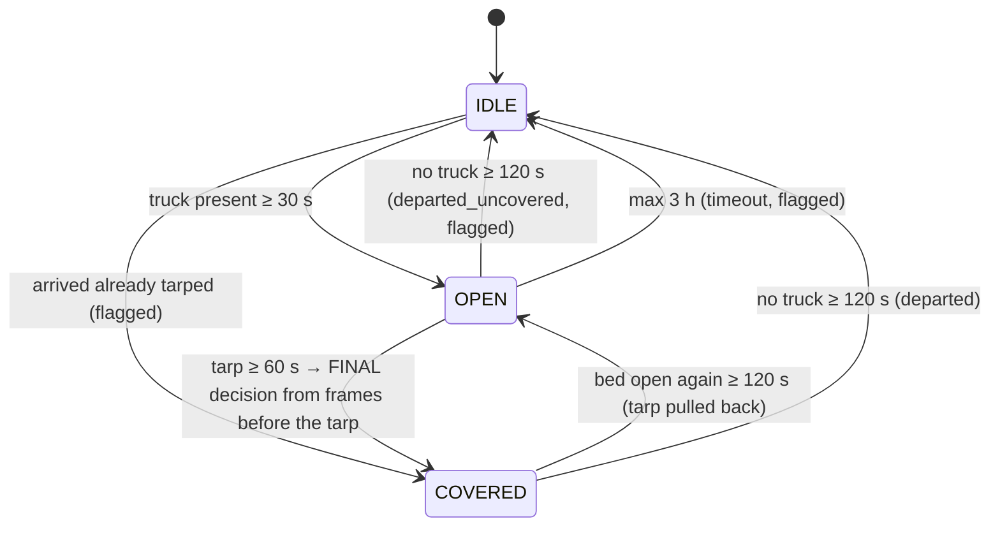

# Architecture

## What the system decides

For every truck at the lacing point (Material Gate, Parsabhata Road) the system records
the **product**: `wire_rod`, or `other` for ingots and other products. Other trucks are logged
for the audit trail, and the heavy model never wakes for them. For wire-rod trucks, before
the tarpaulin goes on, it records:

* **layout**: `linear` | `criss_cross` | `mixed` | `unknown`, with confidence and vote agreement;
* **counts**: *observed* coils, *empty* and *unseen* slots, and an *inferred total* with
  its written basis (e.g. `8 observed + 2 unseen slot(s) assumed occupied (template std_2x5)`);
* **needs_review** with reasons (`arrived_covered`, `layout_votes_disagree`,
  `restarted_mid_visit`, ...);
* an **evidence image**: the bay crop with boxes and slot markers, plus the model versions used.

Observed and inferred counts are never merged. A hidden coil is reported as inferred,
not seen.

## The scene

One fixed camera (verified: all 2026-11-04 clips align within 0.5 px) sees **two lanes**:
the **far** lane along the shed wall, and the **near** lane on the road side, whose trucks run off
the left and bottom image edges. Each lane is a bay with its own polygon, bed homography,
state machine and decisions. Both lanes are often busy at once, for example an ingot truck
in one and a wire-rod truck in the other.

## Data flow

```mermaid
flowchart LR
    CAM[Hikvision main stream<br/>2560x1440 @20 fps] -->|RTSP/TCP, reconnect| BUF[Latest-frame buffer<br/>drop stale, bounded latency]
    BUF --> GUARD{View-drift guard<br/>every 5 min}
    GUARD -->|view moved| ALERT[Alert + suspend]
    GUARD -->|ok| OSD[Blank OSD overlays]
    OSD --> BAY[Per-bay crop<br/>outside polygon blacked out]
    BAY --> LIGHT[Light tier: stage classifier per lane<br/>every 5 s idle / 10 s in visit]
    LIGHT --> SM[Visit state machine per lane]
    OSD --> LB[Shared look-back buffer<br/>last 3 min, full frames]
    SM -->|scheduler wakes| HEAVY[Heavy tier: detector once per frame on the full frame,<br/>coils assigned to a lane by box centre;<br/>layout classifier per lane crop]
    LB -->|tarp detected| HEAVY
    HEAVY --> AGG[Visit aggregator<br/>layout votes + slot board]
    AGG --> DEC[Provisional ~2 min / Final before tarp]
    DEC --> DB[(PostgreSQL<br/>append-only decisions + outbox)]
    DEC --> EV[Evidence JPEGs]
    DB --> OUT[Outbox worker → ERP / alerts<br/>phase 2]
```

## Visit state machine (per bay)

* Transitions need the condition to **hold** (debouncing). Low-confidence frames are
  neutral, and a gap with no frames longer than `max_gap_s` breaks every run. A camera
  outage therefore never looks like "truck left".
* The machine runs on frame timestamps only, so recorded footage replays exactly like the live camera.
* The state is persisted after every event (`machine_state` table). After a restart, an open
  visit resumes and is flagged `restarted_mid_visit`, because in-memory evidence is lost.

## When the heavy model runs (duty cycle)

Over a 45-minute visit the heavy tier runs about 30 times, not 54,000:

0. **Product gate**: nothing heavy runs until the light tier has seen wrapped wire rods
   in at least 3 frames (about 30 s). Ingot and other trucks never wake it.
1. **Provisional window** (first 2 min): every 10 s. The provisional decision is emitted at about 2 min.
2. **After each loading burst**: the change score spikes, then settles. One run per burst.
3. **Checkpoint**: every 10 min.
4. **Tarp detected**: once over the look-back buffer, the last 3 minutes *before* the tarp.
   This is the final decision, built from what the bed looked like just before it was hidden.

`tests/test_pipeline.py::test_heavy_model_sleeps_for_most_of_the_visit` pins this down.

## Slot verification (linear loads)

The bed quad (traced along the tops of the side walls) defines a homography to a unit square.
Coil box centres are projected and binned into a per-layout template grid:
`linear` 2 columns × 5 rows (10) and `criss_cross` 2 × 7 (about 14; to be verified on footage).
`mixed` has no template and falls back to a robust per-frame count. Each slot keeps its last
three observations:

* a slot is **visible** only if its centre is inside the camera view and bay polygon, and not
  under a worker or under a coil that belongs to a nearer slot;
* majority vote gives **occupied** or **empty**. A slot never visible is **unseen** (hidden), or
  **out of view** when its centre lies outside the image. Example: the criss-cross load whose
  last coil is cut off by the frame edge is reported as `13 observed + 1 outside camera view`
  (reason `load_extends_beyond_camera_view`, informational, not a review trigger).

## Storage rules

* `decisions` is **append-only**: corrections supersede (`supersedes_id`), and human reviews
  are separate rows. The audit trail survives disputes with vendors and customers.
* Images live on disk or NAS. The database stores the URI plus SHA-256.
* Results leave via a **transactional outbox**, written in the same transaction as the decision.
* Timestamps are UTC (`timestamptz`) and displayed in IST. Schema changes go through Alembic migrations.
* The NVR remains the continuous video archive. This system keeps only evidence.

## Failure handling

| Situation | Behaviour |
|---|---|
| Camera unreachable or stalled | Reader reconnects with exponential backoff. The state machine treats the gap as "no evidence". |
| View moved (PTZ reset, bumped camera) | ORB match against the reference frame fails. Alert, and decisions are suspended. |
| Truck arrives already covered | Visit opened and flagged `arrived_covered`. Final decision is `unknown`, sent for review. |
| Tarp pulled back to fix the load | `cover_removed`. A new final decision supersedes the old one. |
| Truck leaves without a tarp | Closed as `departed_uncovered` and flagged. |
| Process restart mid-visit | State restored from the database. Visit flagged `restarted_mid_visit`. |
| Workers covering the bed | Occlusion over 40% skips the layout vote. Slots under workers stay unseen. |
| Two trucks in frame | Each bay has its own polygon and state machine. Outside-polygon pixels are blacked out. |

## Why the detector runs on the full frame

The lanes overlap in perspective, because near-lane coil tops reach up into the far lane's
region. Running the detector per lane crop would double the compute and cut boundary coils
in half. It runs at most once per frame timestamp, on the full frame, and the result is cached
for every bay (`runtime/shared.py`). Each bay keeps the coils whose **centre** lies in its
polygon. The light stage classifier and the layout classifier stay per lane, on the lane crop.

## Code map

| Path | Responsibility |
|---|---|
| `io/` | RTSP reader (reconnect, stall detection), latest-frame buffer, video replay |
| `vision/` | geometry and homography, quality metrics, dHash, drift guard, overlays |
| `runtime/` | visit state machine, scheduler, slots, aggregator, pipeline, shared per-frame detections, sinks |
| `models/` | model protocols, Ultralytics backend, bootstrap pre-labeller, fakes and visit-log oracle |
| `store/` | SQLAlchemy schema, repository, DB sink (migrations in `/migrations`) |
| `dataset/` | capture, extract, dedupe, visit log, splits, exports, pre-labelling |
| `eval/` | visit-level metrics against the visit log |
